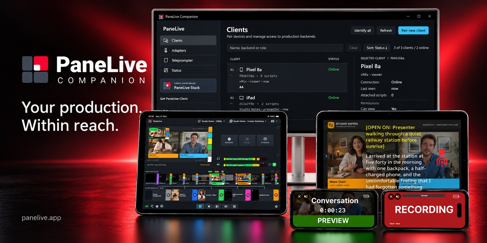

# PaneLive Companion

**Native Windows, macOS and Linux apps for secure mobile production control and monitoring.**

PaneLive Companion connects OBS Studio, vMix, and Streamlabs Desktop to paired Android
and iOS production controllers through an authenticated HTTPS/WebSocket API. Available
controls and monitoring features depend on the selected backend and platform.

For OBS, a separately built helper supplies headless Program and Studio Preview frames
and monitoring audio over WebRTC, without a projector window or desktop capture. On
Windows, vMix supports control, SRT video, and OMT monitoring audio, with optional NDI
adapters. Streamlabs Desktop provides control and performance information on Windows
and macOS. A built-in teleprompter also works independently of these production apps.

This repository contains the native C++20 Companion, its Windows, macOS and Linux
frontends, and the OBS helper. Mobile applications and hosted services are separate
products and are not included here.

[Downloads and SHA-256 verification](docs/DOWNLOADS.md) |
[Build from source](docs/BUILDING.md) | [Install and run](docs/RUNNING.md)

## Features

- **Production control:** adapters for OBS Studio, vMix, and Streamlabs Desktop,
  with controls advertised according to each backend's capabilities. OBS includes
  scene selection, Program/Preview and Studio Mode, transitions,
  source visibility, audio mute and volume, recording and streaming controls,
  profiles and scene collections, thumbnails, and supported hotkeys.
- **Live monitoring:** VP8 Program/Preview video, Opus monitoring audio, audio meters
  and production performance telemetry. Available controls are advertised per backend
  and per client role.
- **Secure pairing:** temporary QR pairing, a pinned gateway certificate, revocable
  device credentials, viewer/operator/admin roles, and local approval for privileged
  operations. Credentials use native operating-system storage.
- **LAN discovery and live state:** DNS-SD discovery, revisioned state updates,
  independent backend reconnects, and queued critical output actions.
- **Native management:** connected clients, adapter controls, settings, pairing,
  diagnostics, client connection notifications, and graceful shutdown through the desktop frontend.
- **Teleprompter:** a script library, per-client script delivery, shared sessions and
  presentation settings, controller/master roles, timed pauses and cue markers,
  progress and voice-follow state synchronization, and a standalone adapter that does
  not require OBS, vMix, or Streamlabs Desktop. Voice recognition runs on the compatible
  master client.
- **Tally and coordination:** recursive source membership for tally evaluation and
  production countdown event relay. Remote tally publication is currently disabled.

## Supported platforms

PaneLive Companion supports **Windows, macOS and Linux**, with a native desktop
interface on each platform. The standalone teleprompter is available on all three.

| Platform | Native interface | Production integrations |
| --- | --- | --- |
| **Windows 10 / 11**, x64 | WinUI 3 / notification area | OBS Studio, vMix, Streamlabs Desktop |
| **macOS 13 or later**, Apple Silicon and Intel | SwiftUI / AppKit | OBS Studio, Streamlabs Desktop |
| **Linux**, Ubuntu and Debian, x86_64 / amd64 | GTK4 / Libadwaita | OBS Studio |

The current version is **0.1.0-beta.1**, a **prerelease**. Available installers,
architectures and signing status are listed in [GitHub Releases](https://github.com/Clownfish-Web/panelive-companion/releases).
macOS uses separate Apple Silicon and Intel builds. See the
[build manual](docs/BUILDING.md) for local evaluation builds on each platform.

### Supported Linux distributions

Linux release installers bundle the application's GTK and media libraries. Use
the standard `.deb` on Ubuntu/Debian, or the CLI system installer on other
compatible x86_64 Linux desktops. Both register the command and desktop menu entry.
See [installation instructions](packaging/linux/README.md). The required baseline
is glibc 2.35+ with normal desktop services; incompatible targets need a source build.

**One `.deb` installer works across all of these verified distributions:**

| Distribution | Supported versions |
| --- | --- |
| **Ubuntu** | **22.04, 24.04, 26.04** |
| **Debian** | **12, 13** |

These x86_64 desktop targets passed installation, GUI and HTTPS startup, autostart,
removal and reinstall checks using the **same installer**, built on Ubuntu 22.04.
Ubuntu 24.04 was also verified on a native desktop. Use current distribution updates
and install with `apt` for standard package management. Application libraries are
bundled privately; desktop services remain supplied by the host.

Other Ubuntu/Debian derivatives and newer releases may work when they provide the
required libraries, but are not yet included in the verified support list.
See [Linux support and validation](docs/LINUX_SUPPORT.md) for requirements and test scope,
including the Linux 5.15 kernel baseline.

The Linux installer **includes the matching OBS helper** and sets it up automatically
for compatible native **OBS 30 or newer** with Qt 6. If OBS is absent or incompatible,
the teleprompter remains usable and the Adapters page explains the OBS requirement.
Installing or upgrading OBS later automatically rechecks helper setup. Ubuntu 22.04
and Debian 12 need a newer OBS package than their stock repositories provide.
Flatpak/Snap OBS cannot load this native helper.
See [Linux installation](docs/RUNNING.md#linux).

An additional source-build preset supports **Arch/Omarchy x86_64**, with native GTK
appearance and an optional desktop widget. Its separate Companion and OBS helper
packages use Arch libraries; the Ubuntu/Debian installer validation above does not
apply to them. See [Arch/Omarchy build instructions](docs/BUILDING.md#archomarchy-x86_64).

### Backend availability

The OBS helper must match the architecture and OBS/Qt development inputs described
in the [build manual](docs/BUILDING.md). Streamlabs currently provides control and
performance information, without Program/Preview video, thumbnails, audio meters or
monitoring audio. vMix is Windows-only. XSplit and Wirecast directories are scaffolding,
not supported integrations. Windows ARM64 and macOS Universal 2 are not advertised as
validated targets.

## Get started

1. Download an available package from [GitHub Releases](https://github.com/Clownfish-Web/panelive-companion/releases)
   and [verify its SHA-256](docs/DOWNLOADS.md), or [build locally](docs/BUILDING.md).
2. Start PaneLive Companion and open **Adapters** in management to configure OBS Studio,
   vMix, or Streamlabs Desktop. Follow the [backend setup instructions](docs/RUNNING.md)
   for your chosen app, or use the standalone teleprompter without a production app.
3. For OBS, close OBS while installing Companion so its matching helper can be set up,
   then restart OBS and enable
   **Tools > WebSocket Server Settings > Enable WebSocket server** with authentication.
   Run Companion in the same user session as OBS and configure its address, port
   (normally `4455`) and password in the OBS adapter.
4. Select **Pair new client** and scan the temporary QR with a compatible mobile client
   on the same LAN. The gateway's default HTTPS port is `7443`.

See [Install and run](docs/RUNNING.md) for platform commands, backend setup,
firewall considerations and troubleshooting. A compatible paired client is required
for mobile controls and media; the Companion is not a browser dashboard.

## Reading the source

| Path | Responsibility |
| --- | --- |
| `app/` | Application composition and API delivery |
| `core/`, `include/studio_remote/` | Portable policy, state, interfaces and IPC contracts |
| `providers/` | Production backend adapters and teleprompter |
| `platform/`, `ui/` | Native services, capture, credentials and management frontends |
| `protocol/`, `generated/protocol/`, `schemas/` | Protocol code, generated types and JSON schemas |
| `obs-plugin/` | Separately built OBS capture/control helper |
| `cmake/`, `packaging/`, `tools/` | Build integration, installer resources and required dependency helpers |

The Companion does not link to OBS. Its helper runs inside OBS and communicates through
versioned local IPC. This public source tree includes runtime and build inputs plus
evaluation manuals; private work notes, test harnesses, IDE settings and build caches
are omitted.

The Companion package and executable are named **`panelive-companion`**. The OBS
helper is named **`panelive-companion-obs-plugin`** and displays **PaneLive Companion**
inside OBS.

## Licenses and acknowledgments

The Companion is licensed under **Apache-2.0**; the OBS helper under
**GPL-2.0-or-later**. Third-party components retain their own licenses.

- [Companion license](LICENSE)
- [OBS helper license](obs-plugin/LICENSE)
- [Project attribution](NOTICE)
- [Third-party notices and dependency provenance](THIRD_PARTY_NOTICES.md)

Thanks to the OBS Project, the teams behind vMix and Streamlabs Desktop, and the
maintainers of the libraries listed in the notices. PaneLive Companion is an independent
project, not affiliated with or endorsed by the OBS Project or the makers of vMix or
Streamlabs Desktop.
Product names and trademarks belong to their respective owners.
